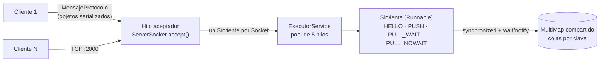

<div align="center">

# Sistemas Distribuidos en Java

**Servidores concurrentes y protocolos propios sobre TCP y UDP, invocación remota con RMI y mensajería con RabbitMQ: el mismo servicio de colas resuelto con varias tecnologías**


<sub>Sistemas Distribuidos · Grado en Ingeniería Informática · Universidad de Valladolid · Curso 2022-2023</sub>

</div>

Servidor de colas de mensajes del laboratorio 2 (`laboratorio-2/programa1`):



## En pocas palabras

- **Reto**: construir servicios cliente-servidor que atiendan a varios clientes a la vez y se comuniquen con un protocolo bien definido.
- **Solución**: una serie de ejercicios en Java que van de hilos y sockets básicos a un servidor de colas de mensajes con protocolo propio, implementado sobre TCP y sobre UDP con sesiones, y comparado con Java RMI y un *broker* real (RabbitMQ).
- **Demuestra**: programación concurrente, redes (TCP/UDP), diseño de protocolos de aplicación, sincronización de estado compartido y sistemas de mensajería.

## Lo más destacado

- **Servidor concurrente con pool de hilos**: un hilo acepta conexiones y entrega cada `Socket` a un `Sirviente` (`Runnable`) que ejecuta un `ExecutorService` de 5 hilos.
- **Protocolo de aplicación tipado**: las primitivas son un `enum` (`HELLO`, `PUSH`, `PULL_WAIT`, `PULL_NOWAIT`...), los mensajes (`MensajeProtocolo`) son `Serializable` y viajan por `ObjectInputStream`/`ObjectOutputStream`, y los malformados lanzan `MalMensajeProtocoloException`.
- **Lectura bloqueante sin espera activa**: `PULL_WAIT` duerme al sirviente con `wait()` sobre el mapa compartido hasta que un `PUSH` lo despierta con `notify()`.
- **Variantes del protocolo**: modificaciones que exigen empezar la sesión con `HELLO` y un protocolo de listas de reproducción (`AUTH`/`ADD2PL`/`WAIT4PL`/`NEWCHAP`/`OVERLOAD`).
- **Mismo problema, varias tecnologías**: colas con clave sobre TCP (laboratorio 2), sobre UDP con sesiones y `PULL_PROMISE` (seminario 1) y con RabbitMQ (colas de trabajo, *publish/subscribe* y *routing*).
- **Estado compartido seguro**: el `MultiMap` compartido se apoya en `ConcurrentHashMap`, sus accesos se protegen con `synchronized` y un `AtomicInteger` cuenta las instancias de `Sirviente`.

## Competencias

| Área | Qué se aplicó |
| --- | --- |
| Concurrencia | Hilos, productor-consumidor, `ExecutorService`, `synchronized`, `wait`/`notify`, `ConcurrentHashMap`, `AtomicInteger` |
| Redes | Sockets TCP (`ServerSocket`, `Socket`) y UDP, servidores de eco y con sesión |
| Protocolos | Primitivas como `enum`, mensajes serializados, manejo de mensajes malformados |
| Middleware | Java RMI (servicio `Hello`), RabbitMQ Java client 5.7.1 con SLF4J |

## Qué contiene

| Carpeta | Contenido |
| --- | --- |
| `minileccion-1`, `minileccion-1.1` | Hilos en Java: `TimePrinter`, y productor-consumidor sobre una cola compartida (`hilosjava`). |
| `minileccion-1.2` | Sockets: `InetAddress`, un servidor TCP y servidores de eco (sencillo, en mayúsculas y multihilo). |
| `minileccion-2` | `MultiMap` / `MapQueue`: colas de mensajes indexadas por clave. |
| `minileccion-3` | Java RMI: servicio `Hello` con cliente, servidor y lanzador. |
| `laboratorio-1` | Servidor TCP multihilo de registro de usuarios ("NETFLIX"): recibe `usuario-contraseña` y los guarda en un `ConcurrentHashMap`. Incluye las tres rondas de correcciones de la entrega. |
| `laboratorio-2` | Servidor TCP de colas de mensajes con *pool* de hilos y protocolo de mensajes serializados, sus variantes con modificaciones y sus correcciones. |
| `seminario-1` | Comunicación UDP: eco, eco con sesión y servidor de colas de mensajes sobre UDP (versiones 1 y 2, la segunda con sesiones y `PULL_PROMISE`). |
| `seminario-2` | Mensajería con RabbitMQ: *hello world*, colas de trabajo (`NewTask`/`Worker`), *publish/subscribe* (`EmitLog`/`ReceiveLogs`) y *routing* (`EmitLogDirect`/`ReceiveLogsDirect`). |

Cada carpeta conserva sus `README` originales. El enunciado de la lección 2 está en [`laboratorio-2/README.pdf`](laboratorio-2/README.pdf).

## Estructura del repositorio

```text
SDist/
├── minileccion-1/ minileccion-1.1/ minileccion-1.2/ minileccion-2/ minileccion-3/
├── laboratorio-1/
│   ├── EchoSencillo/{maquinacliente,maquinaservidor}/
│   └── correcciones/{primera,segunda,tercera}Correccion/
├── laboratorio-2/
│   ├── programa1/                  # Versión base del servidor de colas
│   ├── modificacion/ modificacion1/ modificacionLaboratorio/
│   ├── correciones/
│   └── README.TXT  README.pdf
├── seminario-1/                    # UDP: EjemploEcho, EjemploEchoSession, UDPMultimapa, UDPMultimapaV2
└── seminario-2/                    # RabbitMQ + JAR de dependencias
```

Junto a los fuentes hay `.class` ya compilados en las carpetas de cada paquete.

## Requisitos

- JDK 8 o superior.
- Para `seminario-2`: un servidor RabbitMQ en `localhost`. Los JAR del cliente (amqp-client 5.7.1 y SLF4J 1.7.26) ya están en la carpeta.

## Cómo ejecutarlo

Los ejercicios con `README.md` propio en `seminario-1/` explican paso a paso cómo compilarlos y lanzarlos.

<details>
<summary>Servidor de colas del laboratorio 2 (puerto 2000)</summary>

```sh
cd laboratorio-2/programa1
javac -d . *.java
java protocol.servidor.Servidor          # terminal 1
java protocol.cliente.Cliente localhost  # terminal 2
```

</details>

<details>
<summary>RabbitMQ (seminario 2)</summary>

```sh
cd seminario-2
javac -cp amqp-client-5.7.1.jar Send.java Recv.java
java -cp .:amqp-client-5.7.1.jar:slf4j-api-1.7.26.jar:slf4j-simple-1.7.26.jar Recv   # terminal 1
java -cp .:amqp-client-5.7.1.jar:slf4j-api-1.7.26.jar:slf4j-simple-1.7.26.jar Send   # terminal 2
```

</details>

## Estado y limitaciones

- Con OpenJDK 17 compilan `laboratorio-2/programa1` y, en `seminario-2`, `Send`, `Recv`, `NewTask`, `EmitLog`, `ReceiveLogs` y `ReceiveLogsDirect`. No se ha probado la ejecución.
- `seminario-2/Worker.java` y `seminario-2/EmitLogDirect.java` no compilan tal cual: a una función auxiliar le faltan los operadores de comparación (`if (length 0)`).
- `seminario-2/rabbitmq-java-client` es un submódulo de git sin `.gitmodules`, así que al clonar queda vacío; no hace falta, porque los JAR necesarios ya están en la carpeta.

## Autoría

Javier García González (JavivuG). Parte del código es material base de la asignatura (prof. César Llamas Bello), que se amplió o modificó en las prácticas.

---

<div align="center"><sub>Parte de <a href="https://github.com/JavivuG/UVa-Projects">UVa-Projects</a> · Javier García González</sub></div>
